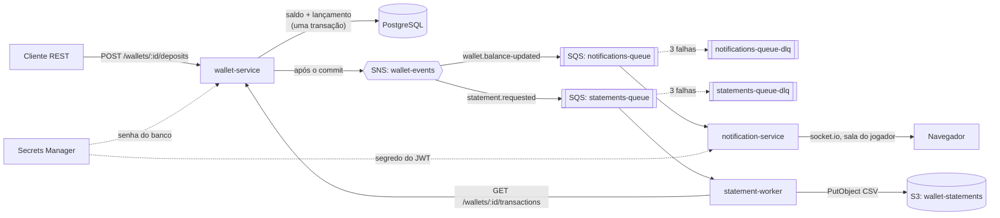

# wallet-platform

Carteira digital de jogadores com dinheiro simulado: cada depósito ou saque vira um lançamento num ledger imutável no PostgreSQL e gera eventos. Outros serviços reagem a esses eventos de forma assíncrona: um avisa o jogador em tempo real por WebSocket e outro gera extratos em CSV no S3.



**Stack:** NestJS 11, TypeScript (estrito), MikroORM 6, PostgreSQL 16, socket.io, AWS SDK v3 (SNS, SQS, S3, Secrets Manager) rodando no LocalStack, pino, Jest, Docker e GitHub Actions.

## Sumário

- [Estrutura do repositório](#estrutura-do-repositório)
- [Como rodar](#como-rodar)
- [Roteiro de demonstração](#roteiro-de-demonstração)
- [Acompanhando uma requisição](#acompanhando-uma-requisição)
- [Decisões de design e por quê](#decisões-de-design-e-por-quê)
- [Segurança](#segurança)
- [Testes e qualidade](#testes-e-qualidade)
- [Limitações conhecidas e próximos passos](#limitações-conhecidas-e-próximos-passos)

## Estrutura do repositório

```text
apps/
  wallet-service/        API REST, domínio, PostgreSQL, publica eventos no SNS
    src/
      players/           módulo de jogadores
      wallets/           módulo de carteiras e ledger
        domain/          Money, Wallet, Transaction, interfaces de repositório
        application/     casos de uso (um por classe)
        infrastructure/  repositórios MikroORM
        presentation/    controllers e DTOs
      statements/        pedidos de extrato
      shared/            erros, filtro HTTP, transação, publicador SNS
      database/          configuração do MikroORM, migrações e seed
    test/                testes e2e (supertest + Postgres real)
  statement-worker/      consome statements-queue e grava CSV no S3
  notification-service/  consome notifications-queue e envia por WebSocket
    public/index.html    página de demonstração
libs/common/             contratos de eventos, logger, correlationId, consumidor SQS, AWS
infra/localstack/        script que cria tópico, filas, DLQs, bucket e segredos
infra/iam/               políticas IAM de privilégio mínimo (referência para a AWS real)
docs/adr/                registros de decisões de arquitetura
```

Dentro de cada módulo a dependência aponta sempre para dentro: `presentation` chama `application`, que usa o `domain`. A `infrastructure` implementa as interfaces (portas) que o domínio e a aplicação definem, então os casos de uso não conhecem MikroORM nem AWS.

## Como rodar

### Pré-requisitos

- **Docker Desktop** (no Windows, com o backend WSL 2, que é o padrão). Nada mais é obrigatório: Node, Postgres e AWS rodam dentro dos containers.
- Opcional, para rodar testes fora do Docker: **Node.js 22**.
- Não é preciso conta AWS: tudo roda no LocalStack.

### Um comando

```bash
docker compose up -d --build --wait
```

A primeira vez leva alguns minutos (download de imagens e build). O `--wait` só termina quando os cinco containers estão saudáveis.

| Serviço | Endereço |
| --- | --- |
| wallet-service (API) | http://localhost:3000 |
| Swagger | http://localhost:3000/docs |
| Página WebSocket | http://localhost:3001 |
| statement-worker (health) | http://localhost:3002/health |
| LocalStack | http://localhost:4566 |
| PostgreSQL | localhost:5432 (usuário `wallet`) |

Para parar: `docker compose down` (ou `docker compose down -v` para apagar também os dados).

Se a porta 5432 já estiver ocupada por outro Postgres, copie `.env.example` para `.env` e mude `POSTGRES_HOST_PORT`.

## Roteiro de demonstração

Os comandos abaixo são para bash. No Windows, use o **Git Bash** (vem com o Git) ou um terminal WSL. No PowerShell, `curl` é outro programa; prefira o Git Bash ou o Swagger em http://localhost:3000/docs.

Atalho: `bash scripts/demo.sh` executa todo o roteiro e pausa para você abrir a página WebSocket.

**1. Criar jogador e carteira**

```bash
curl -s -X POST localhost:3000/players -H 'Content-Type: application/json' \
  -d '{"name":"Ana Souza","email":"ana@example.com"}'
# copie o "id" da resposta
PLAYER_ID=<id do jogador>

curl -s -X POST localhost:3000/players/$PLAYER_ID/wallet
WALLET_ID=<id da carteira>
```

São dois ids diferentes: o do **jogador** (usado na página WebSocket e em `/players/...`) e o da **carteira** (usado em depósitos, saques, saldo e extrato). Se perder algum, recupere pela própria API:

```bash
curl -s "localhost:3000/players?page=1&limit=20"   # lista os jogadores, mais recentes primeiro
curl -s localhost:3000/players/$PLAYER_ID/wallet    # carteira de um jogador
```

**2. Abrir a página WebSocket**

Abra http://localhost:3001/?playerId=SEU_PLAYER_ID e clique em **Conectar**. A página pede um token de teste em `POST /dev/tokens` e se conecta enviando o token no handshake.

**3. Depositar R$ 100,00** (valores sempre em centavos)

```bash
curl -s -X POST localhost:3000/wallets/$WALLET_ID/deposits \
  -H 'Content-Type: application/json' \
  -H 'Idempotency-Key: deposito-001' \
  -H 'X-Correlation-Id: minha-demo' \
  -d '{"amountCents":10000}'
```

A página mostra o novo saldo em menos de um segundo.

**4. Testar a idempotência**: repita exatamente o comando anterior. A resposta é idêntica, o header `Idempotent-Replayed: true` aparece (veja com `curl -i`) e o saldo continua R$ 100,00. Mudar o valor mantendo a chave retorna `422 IDEMPOTENCY_KEY_REUSED`.

**5. Sacar e tentar sacar além do saldo**

```bash
curl -s -X POST localhost:3000/wallets/$WALLET_ID/withdrawals \
  -H 'Content-Type: application/json' -H 'Idempotency-Key: saque-001' \
  -d '{"amountCents":2550}'

curl -s -X POST localhost:3000/wallets/$WALLET_ID/withdrawals \
  -H 'Content-Type: application/json' -H 'Idempotency-Key: saque-002' \
  -d '{"amountCents":999999}'
# 422 INSUFFICIENT_FUNDS
```

**6. Consultar saldo e lançamentos (com filtros e paginação)**

```bash
curl -s localhost:3000/wallets/$WALLET_ID
curl -s "localhost:3000/wallets/$WALLET_ID/transactions?type=DEPOSIT&page=1&limit=10"
curl -s "localhost:3000/wallets/$WALLET_ID/transactions?from=2026-01-01T00:00:00Z&to=2026-12-31T23:59:59Z"
```

**7. Pedir um extrato e baixar pelo S3**

```bash
curl -s -X POST localhost:3000/wallets/$WALLET_ID/statements \
  -H 'Content-Type: application/json' \
  -d '{"from":"2026-01-01T00:00:00Z","to":"2026-12-31T23:59:59Z"}'
# 202 Accepted, status PENDING
STATEMENT_ID=<id do extrato>

curl -s localhost:3000/statements/$STATEMENT_ID
# status READY e downloadUrl (URL pré-assinada válida por 5 minutos)
curl -s "<downloadUrl>"
```

**8. Ver o correlationId atravessando os serviços**

```bash
docker compose logs | grep minha-demo
```

As linhas do wallet-service (requisição HTTP e publicação no SNS) e do notification-service (consumo da fila e envio pelo WebSocket) têm o mesmo `correlationId`.

**9. (Opcional) Ver a DLQ em ação**: envie uma mensagem para uma carteira inexistente. O worker falha 3 vezes e o SQS a move para a DLQ (leva cerca de 3 minutos por causa do visibility timeout de 60 s).

```bash
docker compose exec localstack awslocal sqs send-message \
  --queue-url http://localhost:4566/000000000000/statements-queue \
  --message-body '{"eventId":"teste-dlq","type":"statement.requested","correlationId":"teste-dlq","occurredAt":"2026-01-01T00:00:00Z","payload":{"statementId":"00000000-0000-0000-0000-000000000001","walletId":"00000000-0000-0000-0000-000000000002","from":"2026-01-01T00:00:00Z","to":"2026-02-01T00:00:00Z"}}'

docker compose exec localstack awslocal sqs get-queue-attributes \
  --queue-url http://localhost:4566/000000000000/statements-queue-dlq \
  --attribute-names ApproximateNumberOfMessages
```

## Acompanhando uma requisição

O caminho de `POST /wallets/:id/deposits`, do HTTP até o navegador do jogador:

1. **Correlation ID.** O middleware [correlation-id.middleware.ts](libs/common/src/logging/correlation-id.middleware.ts) lê o header `X-Correlation-Id` (ou gera um UUID), devolve na resposta e guarda num `AsyncLocalStorage` ([correlation.ts](libs/common/src/logging/correlation.ts)). Todo log a partir daqui inclui esse id ([logger.ts](libs/common/src/logging/logger.ts)).
2. **Controller.** [wallets.controller.ts](apps/wallet-service/src/wallets/presentation/wallets.controller.ts) recebe a requisição. O `ValidationPipe` valida o corpo com [movement.dto.ts](apps/wallet-service/src/wallets/presentation/dto/movement.dto.ts) (inteiro, positivo, com limite) e o decorator [idempotency-key.decorator.ts](apps/wallet-service/src/shared/http/idempotency-key.decorator.ts) exige o header `Idempotency-Key`. O controller não tem regra de negócio: só chama o caso de uso.
3. **Caso de uso.** [register-movement.use-case.ts](apps/wallet-service/src/wallets/application/register-movement.use-case.ts):
   - procura um lançamento com a mesma `Idempotency-Key`; se achar, devolve o original (replay);
   - abre uma transação de banco via [mikro-orm-transaction-manager.ts](apps/wallet-service/src/shared/infrastructure/mikro-orm-transaction-manager.ts);
   - carrega a carteira e chama `wallet.deposit(...)`.
4. **Domínio.** [wallet.entity.ts](apps/wallet-service/src/wallets/domain/wallet.entity.ts) valida a regra (valor maior que zero; no saque, saldo suficiente), calcula o novo saldo com [money.ts](apps/wallet-service/src/wallets/domain/money.ts), cria o lançamento [transaction.entity.ts](apps/wallet-service/src/wallets/domain/transaction.entity.ts) e registra os eventos `transaction.created` e `wallet.balance-updated`.
5. **Banco.** Os repositórios ([mikro-orm-wallet.repository.ts](apps/wallet-service/src/wallets/infrastructure/mikro-orm-wallet.repository.ts) e [mikro-orm-transaction.repository.ts](apps/wallet-service/src/wallets/infrastructure/mikro-orm-transaction.repository.ts)) gravam dentro da mesma transação: `UPDATE wallets ... WHERE id = ? AND version = ?` e `INSERT INTO transactions`. Se outra requisição alterou a carteira antes, o `UPDATE` não encontra a versão esperada, tudo é desfeito e o caso de uso tenta de novo (até 3 vezes).
6. **Eventos, depois do commit.** Só com o commit confirmado o caso de uso chama o [sns-event-publisher.ts](apps/wallet-service/src/shared/infrastructure/sns-event-publisher.ts), que embala cada evento com `eventId` e `correlationId` ([wallet-events.ts](libs/common/src/events/wallet-events.ts)) e publica no tópico `wallet-events` com o atributo `eventType`.
7. **Fan-out.** O SNS entrega uma cópia para cada fila assinante cujo filtro aceita o `eventType` (configurado em [init-aws.sh](infra/localstack/init-aws.sh)). `wallet.balance-updated` vai para `notifications-queue`.
8. **Consumo.** No notification-service, o [sqs-consumer.ts](libs/common/src/messaging/sqs-consumer.ts) faz long polling, restaura o `correlationId` e chama o [wallet-event.handler.ts](apps/notification-service/src/application/wallet-event.handler.ts), que ignora eventos repetidos e pede ao gateway para notificar o jogador. A mensagem só é apagada da fila depois do sucesso.
9. **WebSocket.** [notifications.gateway.ts](apps/notification-service/src/presentation/notifications.gateway.ts) emite `balance.updated` para a sala `player:<id>`. Só os sockets autenticados com o token daquele jogador estão nessa sala.

O extrato segue a mesma ideia: [request-statement.use-case.ts](apps/wallet-service/src/statements/application/request-statement.use-case.ts) grava o pedido e publica `statement.requested`; o [generate-statement.handler.ts](apps/statement-worker/src/application/generate-statement.handler.ts) busca os lançamentos pela API, gera o CSV ([statement-csv.ts](apps/statement-worker/src/domain/statement-csv.ts)) e grava no S3; o [get-statement.use-case.ts](apps/wallet-service/src/statements/application/get-statement.use-case.ts) percebe que o arquivo existe, marca o pedido como `READY` e devolve uma URL pré-assinada.

## Decisões de design e por quê

Os detalhes e alternativas consideradas estão em [docs/adr](docs/adr).

**Dinheiro em centavos inteiros.** Ponto flutuante binário não representa 0,10 com exatidão (`0.1 + 0.2 !== 0.3`), e erros de arredondamento em saldo são inaceitáveis. O value object `Money` só aceita inteiros seguros, é imutável e impede operar moedas diferentes. No banco a coluna é `bigint`. ([ADR 0002](docs/adr/0002-dinheiro-em-centavos-e-ledger-imutavel.md))

**Ledger imutável.** Cada movimentação é um novo lançamento, nunca uma edição. Isso dá trilha de auditoria completa, permite reconstruir o saldo a qualquer momento e torna os extratos triviais. A imutabilidade é garantida em três níveis: propriedades `readonly`, repositório sem `update`/`delete` e um trigger no PostgreSQL que recusa `UPDATE` e `DELETE` na tabela. Um `CHECK (balance_cents >= 0)` protege o saldo mesmo se houver bug no código.

**Idempotência.** Redes falham: o cliente pode não receber a resposta de um depósito que deu certo e tentar de novo. Com o header `Idempotency-Key`, a repetição devolve o resultado original sem movimentar dinheiro duas vezes. A garantia final é uma constraint `UNIQUE (wallet_id, idempotency_key)`; se duas requisições com a mesma chave chegarem juntas, a perdedora recebe o resultado da vencedora. ([ADR 0003](docs/adr/0003-idempotencia-e-optimistic-locking.md))

**Optimistic locking.** A carteira tem uma coluna `version`. Duas operações simultâneas na mesma carteira não podem sobrescrever uma à outra (o problema do "lost update"): a segunda falha na checagem de versão, é desfeita e repetida com dados atualizados. Escolhi otimista em vez de `SELECT ... FOR UPDATE` porque conflitos na mesma carteira são raros e não quero segurar locks durante a requisição. O teste e2e de concorrência dispara 8 depósitos simultâneos e confere que o saldo final é exatamente a soma dos aceitos.

**Eventos só depois do commit.** Se o evento fosse publicado antes e a transação falhasse, o jogador seria notificado de um depósito que não existe. Publicando depois, o pior caso é o contrário: dinheiro correto no banco e evento perdido se o SNS falhar naquele instante. Isso fica registrado no log como erro, e a solução definitiva (padrão outbox) está nos próximos passos. ([ADR 0004](docs/adr/0004-eventos-apos-commit-sns-sqs-e-dlq.md))

**SNS + SQS (fan-out).** O wallet-service publica uma vez e não sabe quem consome. Cada consumidor tem sua própria fila, então um serviço lento ou fora do ar não afeta os outros, e as mensagens esperam na fila até ele voltar. Filtros na assinatura fazem cada fila receber só o que interessa. O evento `transaction.created` é publicado, mas hoje nenhuma fila o assina: fica disponível para consumidores futuros (antifraude, por exemplo) sem mudar o wallet-service.

**DLQ.** Uma mensagem que falha sempre (por exemplo, JSON inválido) não pode ficar em loop para sempre consumindo recursos. Depois de 3 recebimentos sem sucesso (`maxReceiveCount`), o SQS a move para a DLQ, onde pode ser analisada e reprocessada manualmente.

**Consumidores idempotentes.** O SQS garante entrega "pelo menos uma vez", então duplicatas acontecem. O notification-service guarda os `eventId` já processados; o statement-worker verifica se o CSV já existe no S3 antes de gerar.

**DDD na medida.** Agregado `Wallet` como única porta de entrada para mudar saldo, value object `Money`, eventos de domínio e repositórios como interfaces. Os casos de uso dependem de interfaces, por isso os testes unitários rodam sem banco. Por pragmatismo, as entidades usam decorators do MikroORM (como `@Entity` do JPA) em vez de um mapeamento separado. ([ADR 0001](docs/adr/0001-ddd-com-camadas-e-entidades-mikroorm.md))

**Cada serviço é dono dos seus dados.** O statement-worker não lê o banco do wallet-service: busca os lançamentos pela API REST. Assim o esquema do banco pode mudar sem quebrar outro serviço.

## Segurança

**O que fica fora do Git**
- `.env` está no `.gitignore`; o repositório só tem o [.env.example](.env.example), sem segredos reais.
- A senha do banco e o segredo do JWT ficam no **Secrets Manager**. Os serviços recebem apenas o *nome* do segredo (`DB_SECRET_ID`, `JWT_SECRET_ID`) e leem o valor na inicialização ([secrets.ts](libs/common/src/aws/secrets.ts)). Rodando `docker compose exec wallet-service env` não aparece a senha do banco.
- O segredo do JWT é gerado aleatoriamente pelo script de init a cada subida do ambiente.
- As credenciais `test`/`test` do docker-compose são as fictícias que o LocalStack aceita; na AWS real as credenciais viriam da role IAM da task/pod, nunca de variável fixa.

**URLs com expiração**
- O download do extrato usa URL pré-assinada do S3 válida por **5 minutos**. O bucket não precisa ser público e quem recebe o link não ganha nenhuma outra permissão.

**Privilégio mínimo**
- Em [infra/iam](infra/iam) há uma política por serviço com só as ações e recursos que ele usa. Exemplos: o notification-service só lê a própria fila e o segredo do JWT; o statement-worker só grava em `statements/*` do bucket; nenhum serviço tem `*` em ação ou recurso.
- Containers rodam com o usuário `node` (não root) e o código pertence ao root, então o processo não consegue alterar os próprios arquivos.

**Outros cuidados**
- JWT com algoritmo fixado (`HS256`) e `issuer` verificado; conexão WebSocket sem token válido é recusada no handshake.
- `POST /dev/tokens` só existe com `ENABLE_DEV_TOKENS=true` (apenas no compose local); em produção o notification-service recusa subir com o segredo de desenvolvimento.
- Validação de entrada com `whitelist` e `forbidNonWhitelisted`: campos desconhecidos são rejeitados.
- Erros 500 não expõem stack trace ao cliente; o detalhe fica no log, ligado pelo `correlationId` que vai no corpo do erro.

## Testes e qualidade

```bash
npm ci
npm test              # unitários: domínio, casos de uso, handlers, gateway WebSocket
npm run db:test:up    # sobe um Postgres descartável na porta 5433
npm run test:e2e      # e2e do wallet-service com supertest contra o Postgres real
npm run lint && npm run format:check && npm run typecheck
```

- **Unitários (48):** `Money`, `Wallet`, casos de uso com repositórios em memória, gerador de CSV, handlers dos consumidores, emissão e validação de JWT e o gateway socket.io com clientes reais.
- **E2E (21):** sobem a aplicação inteira contra PostgreSQL, aplicam as migrações do zero e cobrem idempotência, concorrência, filtros, paginação, erros padronizados e o trigger do ledger. Um teste compara as migrações com as entidades: se alguém mudar uma entidade e esquecer a migração, ele falha.
- **CI:** [.github/workflows/ci.yml](.github/workflows/ci.yml) roda lint, formatação, tipos, testes unitários, e2e (com Postgres como service) e o build das imagens Docker a cada push e pull request.

## Limitações conhecidas e próximos passos

- **Outbox pattern.** Hoje, se o SNS falhar logo após o commit, o evento se perde (o saldo continua correto). O próximo passo é gravar o evento numa tabela `outbox` na mesma transação do lançamento e ter um processo que publica e marca como enviado. Isso garante entrega "pelo menos uma vez" de ponta a ponta.
- **Idempotência dos consumidores em memória.** O notification-service guarda os `eventId` em memória; com várias réplicas ou após reinício, uma duplicata pode passar. Em produção usaria Redis ou DynamoDB com TTL.
- **WebSocket com uma réplica.** Para escalar horizontalmente, o socket.io precisa de um adapter (Redis) para que um evento consumido numa réplica chegue a sockets conectados em outra.
- **Extrato com falha definitiva fica PENDING.** Se a mensagem for para a DLQ, ninguém marca o pedido como `FAILED`. Um próximo passo é o worker publicar `statement.failed` ou o wallet-service expirar pedidos antigos.
- **Migrações na inicialização.** Simples para a demonstração, mas com várias réplicas o ideal é um job de migração separado no pipeline de deploy.
- **Imagens Docker.** Todas as imagens instalam as dependências de produção do monorepo inteiro. Dá para enxugar gerando um `package.json` por app.
- **Infraestrutura como código.** O script do LocalStack serve para o ambiente local; para a AWS real, os mesmos recursos (tópico, filas, DLQs, bucket, segredos e políticas IAM) seriam descritos em **Terraform**.
- **Orquestração.** Deploy em **Kubernetes** (ou ECS), com probes usando os endpoints `/health`, réplicas e escalonamento por tamanho de fila.
- **Autenticação real.** Os tokens vêm de um endpoint de desenvolvimento; num sistema real viriam de um serviço de identidade (Cognito, Keycloak) e a API REST também exigiria autenticação.
- **Observabilidade.** Os logs já têm `correlationId`; o passo seguinte seria tracing distribuído com OpenTelemetry e métricas (por exemplo, idade da mensagem mais antiga em cada fila e tamanho das DLQs com alarme).

## Sobre o uso de IA

Como a IA foi usada no desenvolvimento, o que foi revisado e como validei está em [AI.md](AI.md).
